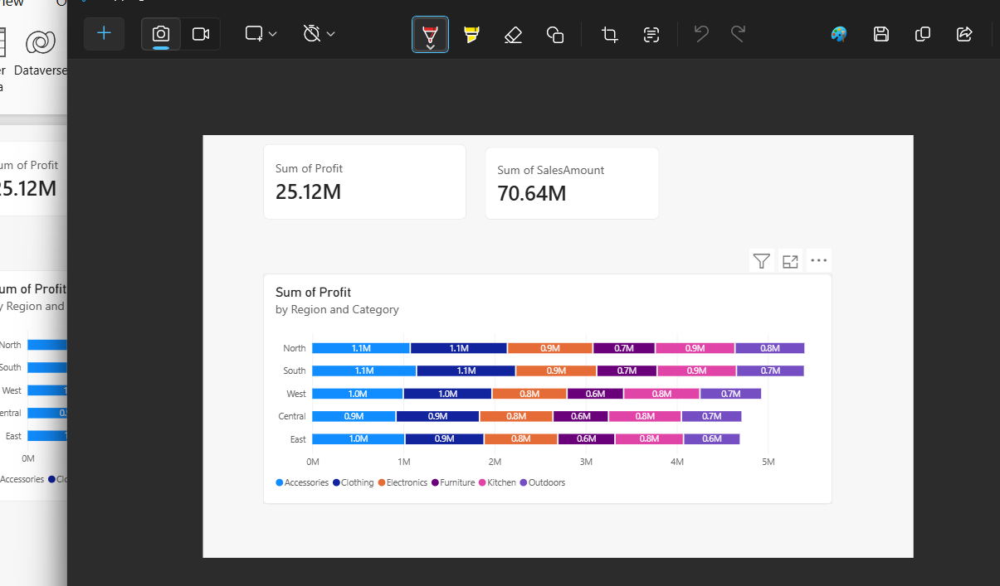

# Sales & Profit Performance Dashboard (Power BI)

## Project Overview
An interactive Power BI dashboard built to analyze sales and profit performance across regions and product categories using a Star Schema data model.

## Key Metrics & Visuals
- **Total Profit:** `25.12M`
- **Total SalesAmount:** `70.64M`
- **Regional & Category Breakdown:** Horizontal stacked bar chart across `North`, `South`, `West`, `Central`, and `East` regions covering `Accessories`, `Clothing`, `Electronics`, `Furniture`, `Kitchen`, and `Outdoors`.

## Key Insights
- `North` and `South` lead overall profit performance across the tracked regions.
- Product categories contribute consistently across regions, with `Accessories` and `Clothing` holding strong shares in top-performing regions.

## Tools & Concepts Used
- Power BI Desktop
- Star Schema Data Modeling (Fact & Dimension tables)
- DAX Aggregations & Clean Dashboard Formatting
